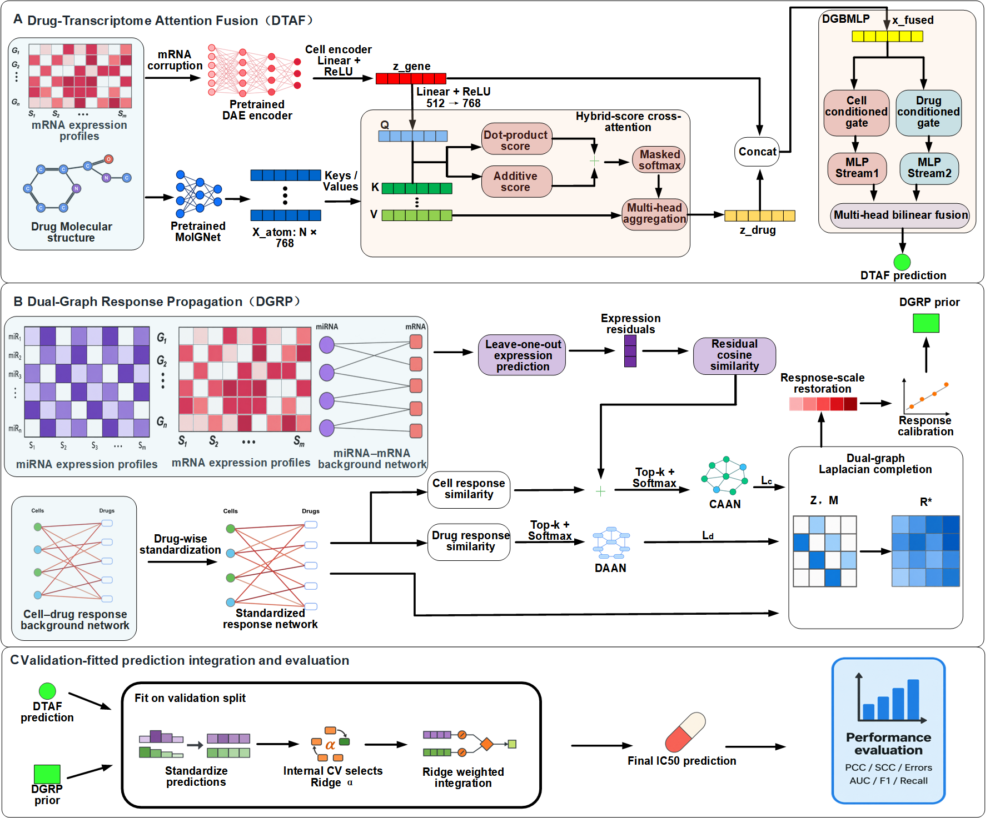

# DTAF-DGRP

## Framework



DTAF-DGRP predicts cancer cell-line drug response by combining a drug–transcriptome prediction with response reconstruction on cell-line and drug similarity graphs.

## Dataset

The [data directory](data/) contains the processed inputs used in the GDSC benchmark. After unpacking, `data/Dataset/` contains the response table, five validation splits, the shared test split, expression profiles and molecular features. `data/PreTrain/` contains the pretrained expression encoder parameters. `data/regulatory/` contains the matched cell lines, miRNA–mRNA pairs and regulatory residual features.

## Run Code

Run the commands from the repository root. The recorded environment uses Python 3.9 and CUDA 12.6.

**1. Install the dependencies.**

```bash
python -m pip install torch==2.8.0 --index-url https://download.pytorch.org/whl/cu126
python -m pip install -r requirements.txt
```

**2. Unpack the data.** Keep all nine archive parts together in the data directory.

```bash
python data/unpack.py
```

**3. Run the model.** The following commands run fold 0. For folds 1–4, change both the fold index and the output directory. Start each training run with a fresh output directory.

```bash
python code/run_gdsc.py train --fold 0 --output outputs/fold0
python code/run_gdsc.py dgrp --fold 0 --output outputs/fold0
python code/run_gdsc.py fuse --fold 0 --output outputs/fold0
```

The final test predictions are written to `outputs/fold0/full_test.csv` and the evaluation metrics to `outputs/fold0/metrics.json`.

## Requirements

- numpy==1.26.4
- pandas==2.3.3
- scipy==1.13.1
- scikit-learn==1.6.1
- joblib==1.5.2
- torch==2.8.0+cu126
- torch-geometric==2.6.1
- rdkit==2025.9.2
- optuna==4.5.0
- threadpoolctl==3.6.0
- matplotlib==3.9.4
- Pillow==11.1.0
- tqdm==4.67.1
- psutil==7.0.0
